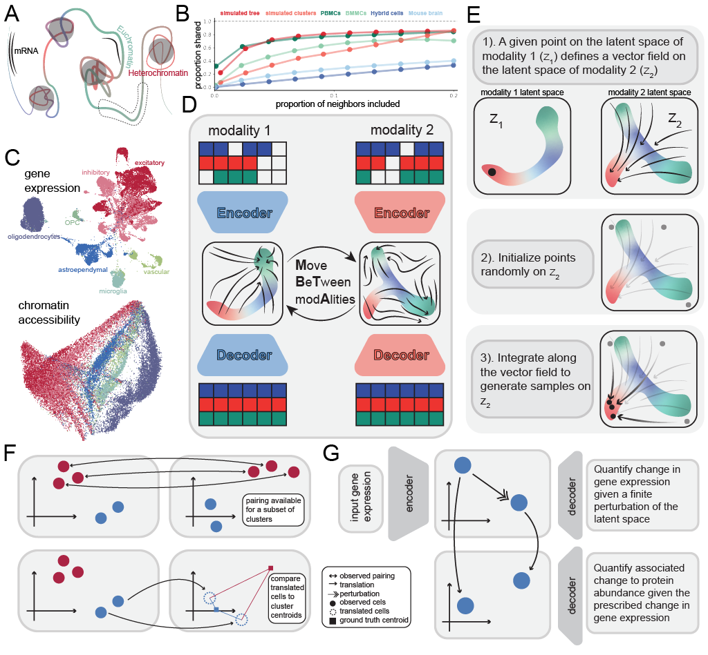

# Move BeTween modAlities (MBTA) employs flow matching to predict single cell data modalities
MBTA is written in python 3.13.2




MBTA allows user to connect any number of modalities together! 


# Getting Started with MBTA

**Move BeTween modAlities (MBTA)** uses flow matching to predict one single-cell
modality from another (e.g. RNA → ATAC, RNA → protein, histone marks → RNA),
guided by cell-level annotations.

This page covers installation only. For actual usage, jump straight to the tutorial
notebooks — each one is self-contained and includes example data.

---

## 1. Clone

```bash
git clone https://github.com/bxxu/move_between_modalities.git
cd move_between_modalities
```

## 2. Create the environment

MBTA is written in Python 3.13. Create the environment from the provided
`environment.yml` (Python 3.13 + all pinned dependencies, verified installable):

```bash
conda env create -f environment.yml
conda activate mbta
```

Note: `torch==2.6.0` from PyPI includes CUDA support (~2.5 GB of NVIDIA wheels).
On a CPU-only machine, you can install a lighter build first:

```bash
pip install torch --index-url https://download.pytorch.org/whl/cpu
```

<details>
<summary>Alternative: minimal pip install</summary>

If you prefer to manage packages yourself:

<pre><code>conda create -n mbta python=3.13
conda activate mbta
pip install -r requirements.txt</code></pre>

<code>requirements.txt</code> lists the core dependencies (PyTorch, scanpy/anndata,
muon, umap-learn, ...).
</details>

## 3. Pick a tutorial

| I want to... | Go to | Data |
|---|---|---|
| Translate between **two paired modalities** (same cells measured twice) | [`tutorial/MBTA_tutorial.ipynb`](tutorial/MBTA_tutorial.ipynb) | bundled: paired RNA + ATAC (`data/multiVITutorial_*.h5ad`) |
| Work with **two modalities in parallel** (RNA ↔ protein, joblib-parallel training) | [`tutorial/MBTA_parallel_tutorial_paired.ipynb`](tutorial/MBTA_parallel_tutorial_paired.ipynb) | external: Kaggle RNA + protein |
| Match **many modalities without paired cells**, using cell annotations | [`tutorial/MBTA_parallel_tutorial_coarse.ipynb`](tutorial/MBTA_parallel_tutorial_coarse.ipynb) | external: mouse embryo histone marks + scRNA |

**Suggested first run:** `MBTA_tutorial.ipynb` — the example data ships with the repo,
so it works out of the box. The other two notebooks download their datasets separately.

## 4. Minimal workflow (30-second version)

Every tutorial follows the same three steps:

```python
import utils_MBTA

# 1. one VAE per modality
model_rna  = utils_MBTA.train_model(rna_tensor,  Nnodes=200, latent_dim=20, ...)
model_atac = utils_MBTA.train_model(atac_tensor, Nnodes=200, latent_dim=20, ...)

# 2. wrap them and train the flow between the two latent spaces
m1 = utils_MBTA.MBTA_submodule(model_rna,  "MBTA", "RNA")
m2 = utils_MBTA.MBTA_submodule(model_atac, "MBTA", "ATAC")
MBTA = utils_MBTA.paired_MBTA(m1, m2)
MBTA.paired_training(rna_tensor, atac_tensor, Nitr=50000)

# 3. translate
translated_rna = MBTA.generate(...)
```

For the full version of each step, see the notebooks above.

---


